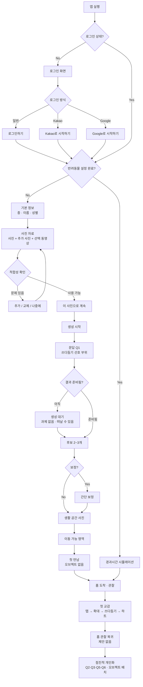

# StayPet MVP User Flow v1.2

기준일: 2026-08-17
동기화 기준: `docs/UX_FINAL.md` (UX 토론 최종 확정본). 충돌 시 `UX_FINAL.md`가 우선한다.

## v1.1 변경 요약
- 생활 문답 6개 일괄 선행 → **Q1만 첫 만남 전**, Q2~Q6은 첫 만남 이후 점진적 개인화
- 기본 오브젝트 첫 만남 전 일괄 배치 → **첫 만남 전 배치 없음**, 필요한 생활 상황에서 하나씩
- 추가 사진·동영상 분기 화면 제거 → 하나의 자료 단계로 통합, 업로드 직후 적합성 확인
- 이동 영역: 칠하기/지우기/미리보기 → **타일 토글**, 별도 지우개·미리보기 모드 제거

## v1.2 변경 요약
- **결정 A** — 문답 3·5 맥락 제안에서 `잘 모르겠어요` 삭제. 비차단이므로 무응답이 곧 유예
- **결정 B** — 문답 5를 개인화 경로 전용에서 **첫 배변 흔적 청소 직후 제안**으로 이동
- **결정 C** — 한 번 나타난 상황형 질문은 **자동으로 사라지지 않는다.** 시간 경과·반복 무시로도 소멸 없음

## Flow 원칙
빠른 첫 만남, 선택적 추가 자료, **첫 만남 전 문답은 Q1 하나**, 홈 몰입, **아무것도 요구하지 않는 관찰 시간 보장**, 미접속 패널티 없음, 핵심 교감 무료.



## 로그인
별도 소개 화면 없음. 풀숲에서 뛰노는 강아지 배경 + StayPet 로고 + 가로형 버튼 3개.

## 등록
기본 정보(종·이름·성별 한 단계) → 사진 자료 → 적합성 확인 → `이 사진으로 계속` → 문답 Q1.

### 기본 정보
강아지/고양이, 이름, 성별을 한 단계에서 입력한다. 종이 선행 항목이며, 종을 바꾸면 문답 4의 레이블과 종별 예시가 즉시 갱신된다.

### 사진 자료
필수 사진 + 추가 사진 + 선택 동영상을 하나의 단계에서 관리한다. `추가 사진이 있나요?`, `동영상을 올릴까요?` 같은 분기 화면과 별도 `건너뛰기`를 두지 않는다.
업로드 성공 시 `업로드 완료`. 업로드 직후 최소 적합성을 확인한다(반려동물 감지, 피사체 너무 작음, 여러 피사체, 심한 가림). 문제가 있으면 `다른 사진 추가` / `이 사진 교체` / `나중에 계속`을 같은 자리에서 제공한다.
품질 점수를 매기지 않고 생성 품질을 보장하지 않는다.

### 생성 시작
사용자가 `이 사진으로 계속`으로 사진을 확정한 시점에 생성이 시작된다.

## 생활 문답

여섯 문항 모두 P0로 유지된다. **제거가 아니라 위치 이동이다.**

### 첫 만남 전 — 문답 1
`내 강아지/고양이가 쓰다듬을 때 좋아하는 부위는?`
머리 / 배 / 엉덩이 / 등. 복수 선택 후 명시적 확인.
첫 쓰다듬기 하트 반응에 직접 필요하므로 첫 만남 전 유일한 필수 문답이다.

### 첫 만남 이후 — 문답 2~6 (점진적 개인화)

설문이 아니라 생활하면서 성향을 조금씩 맞춰가는 경험이다. 미응답 문항은 모두 사용자가 원할 때 열 수 있는 **하나의 개인화 경로**에 모여 있고, 그중 일부만 관련 생활 맥락에서 표면에 떠오른다.

| 문항 | 선택지 | 제시 방식 |
|---|---|---|
| **문답 2 활동량** | 매우 적음 / 적음 / 보통 / 많음 / 매우 많음 | **생활 맥락에서 선택적 제안** — 아이가 집 안을 움직이는 장면 |
| **문답 3 식사 주기** | 하루 1회 미만 / 1회 / 2회 / 3회 / 수시로 | **생활 맥락에서 선택적 제안** — 사용자가 밥을 주는 순간 |
| **문답 4** 강아지 `짖는 정도` / 고양이 `우는 정도` | 거의 없음 / 드물게 / 보통 / 자주 / 매우 자주 | **개인화 경로에 진입했을 때만** |
| **문답 5 배변 주기** | 하루 1회 미만 / 1회 / 2회 / 3회 / 4회 이상 | **생활 맥락에서 선택적 제안** — **첫 배변 흔적을 청소한 직후** |
| **문답 6 수면양** | 매우 적음 / 적음 / 보통 / 많음 / 매우 많음 | **생활 맥락에서 선택적 제안** — 쉬거나 잠드는 장면 |

### 문답 5의 순서
```
보리가 처음 배변 → 사용자가 흔적 발견 → 흔적 탭 → 청소 정상 완료 → 그 직후 비차단 제안
```
청소 전에 묻지 않는다. 배변 발생 즉시 팝업을 띄우지 않는다. 답하지 않아도 정상 생활은 계속된다.

문답 4만 생활 맥락에서 제안하지 않는다. 시스템이 소리 내는 행동을 만들어 두고 그 빈도를 묻는 구조가 되기 때문이다.

빈도형 UI: 왼쪽 적음 → 오른쪽 많음/자주. 단일 선택 즉시 반영이며 나중에 언제든 수정할 수 있다.
**문답 3·5의 맥락 제안에는 `잘 모르겠어요`를 두지 않는다.** 비차단 제안이므로 답하지 않는 것 자체가 미응답이자 유예다. 문답 5의 선택지는 `하루 1회 미만 / 1회 / 2회 / 3회 / 4회 이상` 다섯 개뿐이다.
미응답은 미완료·결핍·경고로 표시하지 않고, 기능 잠금이나 반려동물 불이익을 만들지 않는다.
답이 반영되면 그 변화가 실제 행동에서 드러나야 한다.

## 캐릭터 생성

### 생성 대기
사실로 확인 가능한 상태만 표시한다(예: 사진 확인 → 특징 준비 → 후보 생성). 가짜 진행률과 근거 없는 남은 시간을 만들지 않는다.
**대기를 과제로 채우지 않는다.** 문답을 넣지 않는다.
사용자는 대기 화면을 떠나거나 앱을 닫을 수 있고, 자발적으로 돌아오면 `완료` / `진행 중` / `실패` 중 해당 상태로 복원된다. 완료를 앱 밖으로 푸시하지 않는다.

### 후보와 복구
후보 2~3개 → 선택 → `이 모습으로 계속`.
불만족 시 주 경로는 `다시 준비하기` 하나이며, 열면 `사진을 더하거나 바꾸기` / `기본 정보 확인` / `같은 입력으로 새 후보 받기`가 설명과 함께 나온다.
원본 사진은 상시 병치하지 않고 사용자가 요청할 때만 참조한다.
결과가 불편하면 `지금은 그만 보기`로 이유를 묻지 않고 나갈 수 있으며 입력은 보존된다.
간단 보정은 선택 후보가 가깝지만 조금 다를 때만 진입한다(귀/털/체형/눈/색/무늬). 보정 확정은 한 번이며 후보 화면에서 다시 확정하지 않는다.

## 공간 설정
실제 공간 사진 1장 → 이동 가능 영역 지정.

### 이동 가능 영역
큰 타일을 탭하거나 쓸어서 켜고, **같은 타일을 다시 탭하면 꺼진다**. 별도 지우개가 없다.
도구는 `실행 취소(1단계)` · `전체 초기화` · `완료` 뿐이다.
**별도 미리보기 모드를 만들지 않는다.** 도달 예시를 편집 중 상시 표시한다.
자동 바닥 추정이 가능하면 일부 타일이 켜진 상태로 시작하고, 불가능하면 꺼진 상태로 시작한다. 어느 쪽이든 조작은 같다.
확대는 한 손가락 타일 선택과 충돌해서는 안 된다.

**기본 오브젝트 배치는 이 단계에 없다.**

## 첫 만남
5~10초 → 시스템 문구 `{이름}가 우리 집으로 찾아왔어요.` → 완료 페이지 없이 홈.
**가상 생활 오브젝트를 두지 않는다.** 공간과 캐릭터만 등장한다.
완료 판정은 앱이 foreground인 상태에서 핵심 장면과 시스템 문구가 모두 표시되고 홈 전환이 끝난 뒤에만 기록한다. 그 전에 중단되면 미완료로 두고 복귀 시 이어간다.

## 홈
실제 집 사진 + 캐릭터 중심. UI 최소화.
**첫 교감 직후에는 질문도 배치 제안도 하지 않는다.** 홈 관찰로 돌아간다.

### 캐릭터 터치/쓰다듬기
터치 → 확대 → 부위 문지르기 → 선호 부위면 하트 + 긍정 반응 → 기본 시점 복귀.
확대 상태에서 탭은 짧은 접촉으로 인정한다(실패가 아니다). **실제 문지르기(드래그)만이 본 쓰다듬기**이며, 선호 부위를 문질렀을 때만 하트가 나온다. 반복 탭과 이동 없는 길게 누르기는 하트를 만들지 않는다.
비선호 부위는 오답이 아니다. 중립적 수용 반응을 주고 하트만 생략한다.
종료는 명시적 닫기가 1차, 시스템 뒤로가기가 2차, 안전한 빈 여백 탭이 보조다.

### 상태 말풍선
비상호작용 정보다. 자동으로 사라지고, 말풍선 위 터치는 캐릭터로 전달된다. 밥·놀이의 간접 메뉴로 쓰지 않는다.

### 빈 영역 탭
세계를 바꾸지 않는다. 캐릭터가 탭 지점을 바라보지도 않는다.
빈 영역을 두 번 연속 탭하는 등 명확한 실패 시도가 있을 때만 가장 가까운 유효 대상 하나를 1회 안내한다. **무입력 시간만으로 안내를 띄우지 않는다.**

### 밥
밥그릇 터치 → 급식 → 필요 상태라면 이동/먹기 → 생활 지속.
배고프지 않아도 캐릭터가 반드시 조작을 알아차린다(시선·귀·짧은 몸짓). 강제로 먹이지 않는다.

### 놀이
장난감 터치 → 연결 행동 → 생활 지속.

### 배변
배변 터치 → 치우기 → 흔적 제거. 미청소 패널티 없음.
**첫 배변 흔적을 치운 직후에만** 문답 5(배변 주기)를 비차단형으로 한 번 제안한다. 청소 자체는 그 전에 정상 완료되며 질문 때문에 지연되지 않는다. 청소하지 않고 넘어가면 제안하지 않는다.

### 기본 오브젝트 배치
첫 만남 전에 일괄 배치하지 않는다. 필요한 생활 상황에서 하나씩 배치한다.

| 오브젝트 | 배치 시점 |
|---|---|
| 밥그릇 | 첫 중립적 식사 기회. **첫 하나만 시스템이 제안해 배치 조작 자체를 학습시킨다** |
| 잠자리 | 쉬거나 잠드는 장면. 상황형 제안 또는 사용자가 원할 때 |
| 장난감 | 노는 듯한 행동을 보일 때. 상황형 제안 또는 사용자가 원할 때 |

배치는 드래그와 위치 탭을 모두 허용한다.
**오브젝트가 없어도 반려동물에게 불이익이 없다.** 없는 상태는 정상이며 `배고파요`, 기다림, 불편함, 재촉처럼 결핍으로 읽힐 표현을 사용하지 않는다.

### 상황형 제안 규칙
문답 2·3·5·6과 오브젝트 배치는 같은 성격의 제안이므로 함께 제한한다.
- 한 세션에 **새로 제시하는** 상황형 제안은 최대 1개. 이미 떠 있는 미응답 질문은 새 제안으로 세지 않는다
- 같은 상황에 배치와 질문이 함께 걸리면 배치가 먼저, 질문은 다음 기회로
- 화면을 덮는 모달·진행 차단·확인 요구 없음
- **한 번 나타난 질문은 답할 때까지 화면에 그대로 유지된다.** 시간 경과로도, 여러 번 무시했다는 이유로도 자동 소멸하지 않는다
- **질문이 떠 있어도 관찰·탭·확대·쓰다듬기·오브젝트 조작이 모두 가능하다.** 질문은 흐름을 잡아두지 않는다
- 별도 `건너뛰기` / `나중에 하기` 버튼을 두지 않는다
- 같은 질문을 다시 띄우거나 흔들거나 강조해 재촉하지 않는다
- 미응답·미배치를 배지·카운터·알림·미완료 목록으로 표시하지 않는다
- 나중에 답하면 그때부터 반영한다. 미응답 상태에서도 생활은 정상적으로 계속된다

## 재방문
앱 재실행 → 경과시간 계산 → 생활 이벤트 계산 → 현재 위치/행동/흔적 결정 → 홈 → 사용자가 자연스럽게 현재 상황 발견.
**첫 프레임에서 캐릭터가 보이거나 한 번의 명확한 단서로 즉시 찾을 수 있어야 한다.**
이전과 다른 행동·위치·흔적 중 하나가 드러난다. 활동 보고서·미접속 시간 요약·놓친 보상을 만들지 않는다.
핵심 이유: **"오늘은 아이가 뭐 하고 있을까?"**

## 꾸미기/상점
홈 → 꾸미기 → 보유 아이템 → 배치/이동/회전 → 저장. 상점은 무료/프리미엄 재화로 아이템 구매. 기본 생활 아이템 무료.

## 함께한 날
연속 출석 아님. 누적 방문일. 하루 빠져도 초기화 없음.

## 앨범/추억 사진
앨범 Grid → 상세. 홈 촬영 → UI 숨김 → 저장 → `저장 완료`. 전용 SNS 공유 없음.

## 알림
옵트인. `보리가 지금 쿠션에서 쉬고 있어요.` 같은 생활 소식 허용. `왜 안 왔어요?`, `계속 기다렸어요.` 등 죄책감 유발 금지.

## Low-fi 핵심 상태
로그인, 기본 정보(종·이름·성별), 사진 자료, 사진 적합성 결과, 생성 대기(이탈·복귀 포함), 문답 Q1, 후보, 다시 준비하기, 지금은 그만 보기·재진입, 보정(값 변경·되돌리기·원본 복원·확정), 공간 업로드, 이동 영역(타일 토글·유효성 미달 복구), 첫 만남, 홈 기본, 캐릭터 확대, 쓰다듬기, 하트 반응, 말풍선, 빈 영역 탭 힌트, 먹기, 놀이, 배변 흔적·청소, 상황형 오브젝트 배치 제안, 상황형 문답 제안(Q2·Q3·Q5·Q6), 미응답 질문 유지 상태, 개인화 경로(Q4 포함), 재방문 첫 프레임, 꾸미기, 상점, 함께한 날, 앨범, 추억 사진, 설정.

Low-fi 1차 범위와 제외 항목은 `UX_FINAL.md` §9·§10을 따른다.
